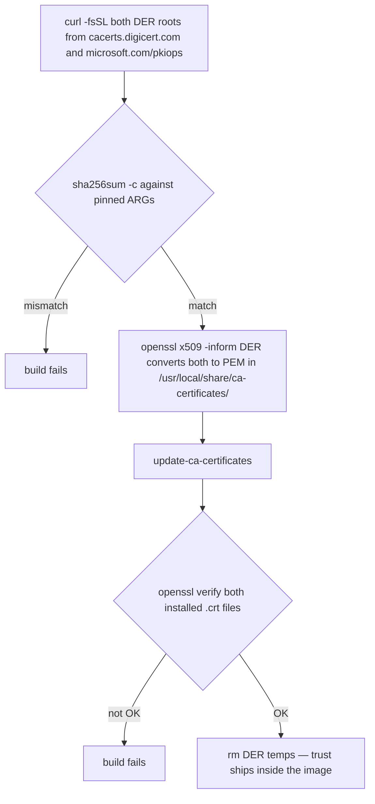

## Summary

Bake the two root CAs Azure Database for PostgreSQL Flexible Server currently uses — DigiCert Global Root G2 and Microsoft RSA Root CA 2017 — into the image's system trust store at build time, with SHA256-pinned downloads and in-build assertions. Root CAs only, no runtime steps. Smoke-test gated; PR (which closes #15) opened only after explicit user approval.

## Problem Frame

The `cyrilgdn/postgresql` Terraform provider is a Go binary that verifies server certificates only against the container's system trust store and never downloads missing CAs. With `sslmode = "verify-full"` against Azure Database for PostgreSQL Flexible Server, `terraform plan/apply` fails with `x509: certificate signed by unknown authority` when the roots are missing. Both roots already ship in the distro store on every ubuntu-24.04-based image — re-verified 2026-10-15 against the pristine base (`mcr.microsoft.com/devcontainers/base:ubuntu-24.04`, `ca-certificates 20240203`): `DigiCert_Global_Root_G2.crt` and `Microsoft_RSA_Root_Certificate_Authority_2017.crt` are both present in `/usr/share/ca-certificates/mozilla/`. Issue #15 was raised pre-emptively (no observed failure), and its first requirement is conditional: use the distro's standard CA package if it already includes the roots, otherwise add them explicitly at build time. This plan deliberately takes the explicit-add branch: the requirement is that both roots are always present regardless of base image used, and `Dockerfile:45` installs `ca-certificates` unpinned — distro presence is not durable across weekly rebuilds or a base-image swap. The change is determinism hardening, not a gap fill. Microsoft's TLS guidance (updated 2026-07) confirms both roots are current, that clients should hold exactly these roots, and that intermediates/server certs must never be pinned because Microsoft rotates them without notice.

## Requirements

**Trust store**
- R1. Both roots present in the image's system trust store — `/etc/ssl/certs/ca-certificates.crt` plus the hash-symlink directory — readable by every user including the non-root `vscode` user the image ends as (issue acceptance criterion: fresh container has both)
- R2. Root CAs only — no intermediate CAs, no server certificates baked
- R3. Trust comes entirely from the image — zero runtime or per-session steps

**Integrity and build-time verification**
- R4. Each download gated by `sha256sum -c` against a pinned `ARG`; pins equal the CCADB-published SHA256 fingerprints of the two roots
- R5. In-build assertions fail the build on checksum mismatch, conversion failure, or `openssl verify` not returning OK for either root; nothing parses or greps `update-ca-certificates` output text

**Documentation**
- R6. `.env.example` mirrors both hash `ARG`s exactly, in a new group, with source links in the version-reference header

**Process**
- R7. Smoke test (`docker build .`) passes and is reported before any PR; PR opened only after explicit user approval per repo ABSOLUTE DIRECTIVE; PR body contains `Closes #15`
- R8. Acceptance demonstrated in a fresh container as the `vscode` user via `openssl verify` of both installed roots

---

## Key Technical Decisions

- **Explicit add of both roots — churn insurance over the unpinned distro package (issue #15 override).** Both roots ship in the distro store today — the pristine base image (`ca-certificates 20240203`) and current builds (`20260601~24.04.1`) both carry them — so the issue's distro-first branch would technically hold right now. The explicit add is the deliberate override: the requirement is that both roots are always present regardless of base image used, `Dockerfile:45` installs `ca-certificates` unpinned, and a future distro removal (e.g. a Mozilla distrust) must not silently drop a root Azure still chains to.
  - *Rejected alternative: assert-only tripwire* — `openssl verify` of both roots against the distro store, no `/usr/local` install, turns the weekly cacheless cron into a missing-root tripwire with zero rotation duty. Rejected because it detects rather than prevents: the store goes red and stays incomplete until an operator acts, while explicit pins keep it complete through a distro drop.
  - Duplicates are harmless: `update-ca-certificates` reports `2 added` and rehash emits `skipping duplicate certificate` per duplicate as a warning, not an error (verified empirically).
- **Download DER → convert to PEM → `/usr/local/share/ca-certificates/` → `update-ca-certificates`.** Both vendor URLs serve DER (verified by download). `openssl x509 -inform DER` converts; `openssl` 3.0.13 is present in the base image at `/usr/bin/openssl`. This is the canonical Debian flow, and Go's crypto/x509 reads the resulting bundle and hash directory by default.
- **SHA256 pins as `ARG`s, mirrored in `.env.example`.** Extends the existing Terragrunt/Packer `sha256sum -c` precedent; cert publishers ship no `SHA256SUMS` file, so the hashes are hardcoded. The file hash equals the cert hash, which equals the CCADB-published fingerprint — the pin doubles as an identity pin. `ARG` + mirror keeps the all-ARGs mirror invariant intact; a new group holds them because hashes are not versions.
- **Late placement: own banner block directly before `USER vscode` (Dockerfile:608).** Bump-isolation is the property the ARG-per-block layout exists for — a future pin or URL change rebuilds only this block. Collocating after the system-packages layer (the az-ssh "next to the thing it extends" precedent) was rejected: it would invalidate all ~25 tool layers below on every future cert change. A trust-store change is cross-cutting image infrastructure, kin to the other late system-level blocks.
- **Assert via `openssl verify` only.** Trusted-first verification of each installed `.crt` returns OK iff the root is in the store — deterministic and proven in the base image. It proves store membership, not which copy (distro or explicit) supplied trust. `update-ca-certificates` stdout is not a stable contract: on current builds (both roots distro-present) it reads "2 added, 0 removed" plus two duplicate-skip warnings; the added-count tallies created symlinks, so it stays "2 added" even for full duplicates (verified empirically), while the warning count shifts with distro contents. Never parse it.
- **`rm` the DER temp files in the same `RUN`.** Matches every other download block's hygiene.
- **Checksum gate scope: cacheless builds only.** A cached `RUN` does not re-execute, so vendor byte drift is detectable only when the layer rebuilds — the weekly Monday cron (which skips cache-from) is the drift tripwire. Local warm-cache and possibly PR builds reuse the layer.
- **Rotation runbook: URL + hash `ARG` + mirror edited as one unit; add-new-first, remove-old only after Azure's retirement date passes.** Azure rotates roots with dual-signed chains, so both anchors must coexist during transition. A hash-only bump cannot fix a moved URL (the `pkiops` layout has changed historically). Pinned roots also bypass distro/Mozilla distrust decisions — watch CCADB bulletins; removing a baked root is a deliberate image change.

---

## High-Level Technical Design

One `RUN` block, every failure loud:



Directional sketch of the block shape (not the literal final Dockerfile text):

```dockerfile
# --- Azure Database for PostgreSQL TLS root CAs (issue #15) ---
# banner: why (Go provider, verify-full), roots-only rationale, expected
# duplicate-warning note, arch-independent (PEM), drift-tripwire note
ARG DIGICERT_GLOBAL_ROOT_G2_SHA256=cb3ccb...
ARG MICROSOFT_RSA_ROOT_CA_2017_SHA256=c741f7...

RUN curl -fsSL <digicert-url> -o /tmp/... \
    && curl -fsSL <microsoft-url> -o /tmp/... \
    && echo "${DIGICERT_GLOBAL_ROOT_G2_SHA256}  /tmp/..." | sha256sum -c \
    && echo "${MICROSOFT_RSA_ROOT_CA_2017_SHA256}  /tmp/..." | sha256sum -c \
    && openssl x509 -inform DER -in /tmp/... -out /usr/local/share/ca-certificates/az-postgresql-...crt \
    && openssl x509 -inform DER -in /tmp/... -out /usr/local/share/ca-certificates/az-postgresql-...crt \
    && update-ca-certificates \
    && openssl verify /usr/local/share/ca-certificates/az-postgresql-...crt \
    && openssl verify /usr/local/share/ca-certificates/az-postgresql-...crt \
    && rm /tmp/...
```

Exact values for the implementer:

| Item | Value |
|---|---|
| DigiCert Global Root G2 URL | `https://cacerts.digicert.com/DigiCertGlobalRootG2.crt` (DER) |
| DigiCert Global Root G2 SHA256 | `cb3ccbb76031e5e0138f8dd39a23f9de47ffc35e43c1144cea27d46a5ab1cb5f` |
| Microsoft RSA Root CA 2017 URL | `https://www.microsoft.com/pkiops/certs/Microsoft%20RSA%20Root%20Certificate%20Authority%202017.crt` (DER) |
| Microsoft RSA Root CA 2017 SHA256 | `c741f70f4b2a8d88bf2e71c14122ef53ef10eba0cfa5e64cfa20f418853073e0` |
| Installed filenames | `/usr/local/share/ca-certificates/az-postgresql-digicert-global-root-g2.crt`, `/usr/local/share/ca-certificates/az-postgresql-microsoft-rsa-root-ca-2017.crt` |

---

## Implementation Units

### U1. Add Azure PostgreSQL root CA block to Dockerfile

- **Goal:** Both roots in the system trust store at build time, every gate loud
- **Requirements:** R1, R2, R3, R4, R5
- **Dependencies:** none
- **Files:** `Dockerfile`
- **Approach:** Banner-commented block directly before `USER vscode`, two `ARG` pins above a single `RUN` per the HTD pipeline. The checksum pin subsumes identity — no separate subject-string assertion needed. Banner documents the expected `skipping duplicate certificate` warnings so nobody "fixes" them later, and carries the rotation rule: URL + hash `ARG` + mirror edit as one unit, add-new-first, remove-old only after Azure's retirement date passes.
- **Patterns to follow:** Terragrunt block (`Dockerfile:183`) for the `sha256sum -c` gate shape; az ssh extension block (`Dockerfile:333`) for in-RUN assertion doctrine and banner style
- **Test scenarios:**
  - Happy path: `docker build .` passes; `update-ca-certificates` reports "2 added, 0 removed" plus two duplicate-skip warnings (ca-certificates `20260601~24.04.1` ships both roots); `openssl verify` OK for both roots
  - Edge: distro later drops a root (e.g. Mozilla distrust) → the explicit copy still lands in the store; one duplicate warning disappears, counter stays "2 added"; build stays green because assertions are verify-only
  - Error path: vendor serves different bytes → `sha256sum -c` fails the build (negative test: temporarily corrupt one pin and confirm the build fails, then restore)
  - Error path: root missing from the bundle → `openssl verify` exits non-zero, build fails
  - Integration: PR CI build passes on `linux/amd64` and `linux/arm64` under QEMU — PEM roots are arch-independent, no `TARGETARCH` handling
- **Verification:** Smoke build completes; both installed `.crt` files verify against the store inside the built image

### U2. Mirror SHA256 pins in .env.example

- **Goal:** Mirror invariant intact — every new `ARG` has an exactly-matching entry
- **Requirements:** R6
- **Dependencies:** U1 (ARG names and values)
- **Files:** `.env.example`
- **Approach:** New group (e.g. `# Azure PostgreSQL TLS root CAs — sha256 pins, not versions`) with both entries; version-reference header gains the Microsoft Learn TLS page and the two vendor cert URLs as source links
- **Patterns to follow:** Existing group + version-reference-header structure in `.env.example`
- **Test expectation:** none — mirror-only documentation change
- **Verification:** Each `ARG` default equals its mirror value exactly; no other lines touched

### U3. Smoke test, fresh-container acceptance, approval-gated PR

- **Goal:** Prove the change end-to-end and gate the PR per repo directive
- **Requirements:** R1, R7, R8
- **Dependencies:** U1, U2
- **Files:** none — validation only
- **Approach:** First run a baseline check against the current published `latest` — fresh container, `openssl verify /usr/share/ca-certificates/mozilla/DigiCert_Global_Root_G2.crt /usr/share/ca-certificates/mozilla/Microsoft_RSA_Root_Certificate_Authority_2017.crt` — and report it; both roots are expected to verify already (the issue was pre-emptive, no observed failure), so the baseline documents current state and would surface an unexpected gap. Then run `docker build -t devops-toolbox:local .` and report the result (ARG defaults suffice; no `.env` needed). Then, in a fresh container as the shipping user: `docker run --rm -u vscode devops-toolbox:local bash -c "openssl verify /usr/local/share/ca-certificates/az-postgresql-digicert-global-root-g2.crt /usr/local/share/ca-certificates/az-postgresql-microsoft-rsa-root-ca-2017.crt"` — both must print OK. Await explicit user approval; then open the PR with `Closes #15` in the body, noting the issue's distro-first conditional and this plan's explicit-add override (roots always present regardless of base image).
- **Test scenarios:**
  - Happy path / acceptance: fresh container as `vscode` — `openssl verify` prints OK for both roots (issue acceptance criterion, no live Azure server needed)
  - Edge (consumer note): `verify-full` also enforces hostname — an `x509: HostnameError` is a hostname problem, not a missing-CA symptom; don't reopen #15 for it. If `x509: certificate signed by unknown authority` persists while both roots verify, the cause is elsewhere (stale local image, alternate chain) — re-diagnose rather than reopen
- **Verification:** Build result reported to the user; acceptance command output shown; PR opened only after explicit approval

---

## Scope Boundaries

Non-goals for this plan:

- Intermediate CAs or server certificates — unsupported client configuration per Microsoft's TLS guidance; breaks on unannounced rotation
- Runtime or per-session CA fetch — the issue requires trust baked into the image
- Java truststore (`cacerts`) or other per-runtime stores — Go reads the system store; no request beyond it
- Roots for other providers (AWS RDS, GCP SQL) — not requested
- README table change — CA trust is a facet of the image, not a new tool (az ssh precedent)
- CI workflow changes — none needed; existing PR/weekly builds exercise the new block as-is

### Deferred to Follow-Up Work

- `docs/solutions/` entry for TLS-trust installation — capture via ts-compound after the change lands; no prior learning covers TLS trust stores
- CONCEPTS.md Version-mirror wording — the entry currently says "every version `ARG`"; update it to state the mirror covers every Dockerfile `ARG`, version pins and SHA256 pins alike (this plan introduces the image's first non-version ARGs)
- Pre-existing `.env.example` drift (`POSTGRESQL_CLIENT_VERSION=18` has no matching Dockerfile `ARG` since commit 98758e0) — tracked by the existing mirror-check issue; explicitly not this PR's scope
- Automated ARG/mirror drift checking — separate concern, already tracked

---

## Risks & Dependencies

- **Vendor host availability:** `cacerts.digicert.com` or `microsoft.com/pkiops` unreachable → build fails loudly at this `RUN`. Same accepted network-dependency class as every `curl` already in the Dockerfile; the weekly cron retries.
- **URL churn:** the `pkiops` path layout has changed historically. A moved URL fails the build at download (curl exit code 7/28/60), not at the checksum gate; recovery is the one-unit rotation edit (URL + `ARG` + mirror).
- **TLS bootstrap:** the downloads themselves verify against the pre-existing store. If a vendor host later serves a chain the old store cannot verify, the failure is a curl TLS error (exit 60), not a checksum mismatch — distinct signature, don't misdiagnose the weekly-red scenario.
- **Pinned-trust blind spot:** explicit roots bypass future distro/Mozilla distrust decisions for these CAs. Watch CCADB bulletins; removing a baked root is a deliberate image change, never a passive drift.
- **Cache-blind gate:** the checksum re-executes only on cacheless builds; the weekly cron is the tripwire. A warm-cache local or PR build reusing the layer proves nothing about current vendor bytes.
- **Duplicate roots:** distro entries + explicit entries coexist in the bundle — harmless for verification; the expected rehash warnings are documented in the block banner.
- **Layer cache:** block sits directly before `USER vscode`; inserting it invalidates nothing below, and future pin bumps rebuild only this block.

---

## Sources & Research

- Issue #15 — the origin request, root URLs, and constraints
- Microsoft Learn, *TLS in Azure Database for PostgreSQL Flexible Server* (ms.date 2026-07-14): both roots current, dual-signed chains, ICA rotation through Q1 2026, roots-only client guidance, China-regions root rotation March 2026
- Empirical validation in `mcr.microsoft.com/devcontainers/base:ubuntu-24.04` (ca-certificates 20240203): both roots present in `/usr/share/ca-certificates/mozilla/` (re-verified 2026-10-15 — an earlier check wrongly reported DigiCert Global Root G2 absent), `openssl` 3.0.13 present; full pipeline (DER download → sha256 verify → PEM convert → `update-ca-certificates` → `openssl verify`) exercised successfully. As-built re-check 2026-10-15: `apt-get update && apt-get install ca-certificates` in the base image resolves `20260601~24.04.1`, also with both roots; installing a duplicate root yields `1 added` plus `skipping duplicate certificate` — the added-count tallies created symlinks
- CCADB-published SHA256 fingerprints match the computed file hashes — authenticity cross-check for the pins
- `Dockerfile:45` (ca-certificates package), `Dockerfile:183` (Terragrunt checksum gate), `Dockerfile:333` (az ssh assertion block), `Dockerfile:608` (`USER vscode`)
- `CONCEPTS.md` — ARG-per-block convention, Version mirror, Smoke test
- Prior plans: `docs/plans/2026-06-14-001-feat-terraform-bump-terragrunt-add-plan.md` (checksum verification + negative-test precedent), `docs/plans/2026-09-25-001-feat-az-ssh-extension-add-plan.md` (in-build assertion and approval-gate shape)
