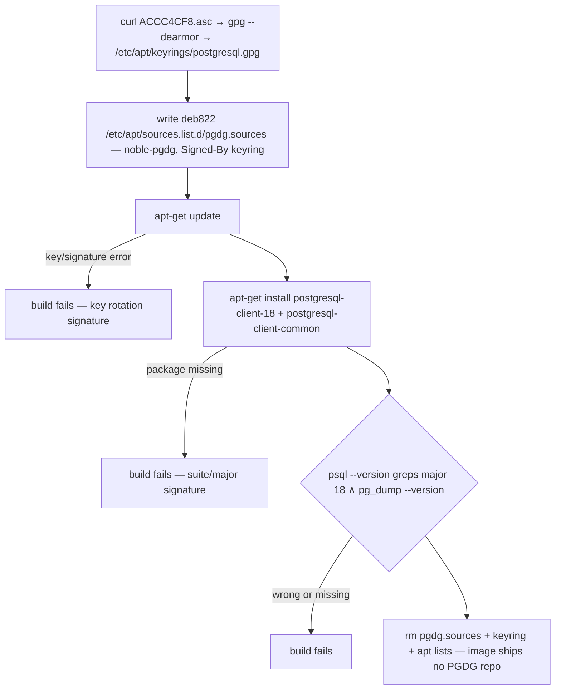

## Summary

Install the PostgreSQL 18 client suite (`postgresql-client-18` — psql, pg_dump, pg_restore, pg_dumpall, pg_basebackup) from the official PGDG apt repository, restoring what commit `98758e0` removed in error the day PR #7 added it. Major-float pin (`ARG POSTGRESQL_CLIENT_VERSION=18`), own banner block at the Dockerfile tail, assertions in-RUN. Smoke-test gated; PR only after explicit user approval.

## Problem Frame

The image currently installs only `postgresql-client-common` (Dockerfile:67) — the pg_wrapper machinery without any underlying client. `/usr/bin/psql` resolves to a wrapper that fails with "You must install at least one postgresql-client-<version> package"; there is no working psql, and the README has advertised one since PR #7. History: PR #7 (commit `17bf1ec`, 2026-04-27) added a PGDG-based `postgresql-client-18` block that passed CI on both architectures; hours later commit `98758e0` ("Fix: Postgres tools install method", no PR, no body) deleted the entire block — the user confirms this was a misbehaving AI model, not a technical failure. The removal also stranded `POSTGRESQL_CLIENT_VERSION=18` in `.env.example` as the repo's one known Version-mirror drift (tracked alongside issue #14). Ubuntu noble ships only the PG16 client, so PG18 requires the PGDG repo — the mariadb-client "no version-addressable repo" exception does not apply. The user's environments standardize on PG 18 (homelab CloudNativePG clusters, one backend with a PG 18+ hard requirement), so a major-matched client matters for `pg_dump` compatibility.

## Requirements

**Client installation**
- R1. `psql`, `pg_dump`, `pg_restore` invocable by the non-root `vscode` user; `psql --version` reports PostgreSQL 18.x
- R2. Version comes from PGDG `noble-pgdg` as a major-float: package name locks major 18, point releases resolve fresh per build; no package-version pin
- R3. No server packages pulled (`postgresql-18` server appears only in Suggests); `postgresql-client-common` upgrades consciously to the PGDG build by being named in the install list
- R4. PGDG repo config (sources file, key) is removed after install; the image ships no PGDG repo definition or key

**Build integrity**
- R5. In-RUN assertions fail the build unless `psql --version` reports major `${POSTGRESQL_CLIENT_VERSION}` and `pg_dump --version` resolves
- R6. `ARG POSTGRESQL_CLIENT_VERSION` declared directly above the install RUN (ARG-per-block); a bump invalidates only this block downward

**Documentation**
- R7. `.env.example` `POSTGRESQL_CLIENT_VERSION=18` matches the ARG default exactly (entry already exists; expected edit: none); CLAUDE.md install-method priority and key conventions updated for the second third-party-apt tool
- R8. Block banner documents: why PGDG over Ubuntu (noble ships PG16 only), the float rationale, the expected `postgresql-client-common` upgrade, weekly-red triage signatures, and the removal history (`PR #7` → `98758e0`) as recurrence defense

**Process**
- R9. Smoke test (`docker build .`) passes and is reported before any PR; PR opened only after explicit user approval per repo ABSOLUTE DIRECTIVE; fresh-container acceptance as `vscode` demonstrates R1

---

## Key Technical Decisions

- **PGDG via deb822 `.sources` + dearmored key at `/etc/apt/keyrings/postgresql.gpg`.** The vendor-documented format as of 2026 is deb822; the traditional `deb [signed-by=…] … noble-pgdg main` one-liner (what PR #7 used) still parses but is no longer the documented snippet. Key goes to `/etc/apt/keyrings/` via `gpg --dearmor` — the Azure CLI block precedent (Dockerfile:319-321) — not to the official snippet's `/usr/share/postgresql-common/pgdg/apt.postgresql.org.asc`: that directory does not exist in this image (Ubuntu's `postgresql-client-common` does not ship it), and a key placed there can become dpkg-owned when the PGDG `postgresql-client-common` upgrade ships the same path, making post-install cleanup delete a package-owned file.
- **Major-float: `ARG POSTGRESQL_CLIENT_VERSION=18` feeds the package name `postgresql-client-${POSTGRESQL_CLIENT_VERSION}`.** User decision. PGDG keeps only three package versions in its index (announced 2026-04-23; 18.0–18.2 already pruned), so an exact point pin breaks the weekly cacheless build within ~two point releases. Float delivers point/security releases automatically via the weekly rebuild; the ARG remains for mirror integrity and deliberate major bumps (18→19 is an explicit edit).
- **`postgresql-client-common` is named explicitly in the install list.** The client-18 dependency floor (`>= 182~`) is already satisfied by Ubuntu's installed `257build1`, so an implicit install would silently keep the Ubuntu wrapper while the plan's expectations assume the PGDG one. Naming it resolves the candidate to PGDG `293.pgdg24.04+1` (its `Breaks/Replaces: postgresql-common (<< 269)` is moot — `postgresql-common` is not installed). The whole PG stack then comes from one source: client-18, `libpq5 >= 18.6` (PGDG; Ubuntu ships 16.x), and client-common.
- **Tail placement: own banner block directly before `USER vscode`, after the Azure PostgreSQL TLS root CAs block.** Zero layers below to invalidate on introduction; future ARG bumps rebuild only this block; groups the image's two PostgreSQL-related blocks. Colocation in the system-packages layer is rejected — the repo add would fuse into the most-invalidated layer in the file, and that layer has no PGDG source to install from.
- **Full `apt-get update` in the block, not a scoped `-o Dir::Etc::sourcelist` update.** Azure CLI precedent; scoped updates are obscure and have no repo precedent. Cost: the update also refreshes the persisted `azure-cli.list` and Ubuntu indexes, so a transient third-party outage can redden this layer — documented in the banner's triage note instead of engineered around.
- **Assertions az-ssh style (Dockerfile:356-359), not bare `psql --version`.** A wrong-major install exits 0 on bare invocation; grep the major: `psql --version | grep "psql (PostgreSQL) ${POSTGRESQL_CLIENT_VERSION}\."` plus a `pg_dump --version` check.
- **No GPG fingerprint pin on the PGDG key.** The key arrives over TLS from postgresql.org — same trust class as the unpinned Microsoft key in the Azure CLI block. The CA-block sha256 pins are cert identity pins, not a key-download precedent.
- **`postgresql-client-common` stays in the system-packages layer (Dockerfile:67).** Removing it would invalidate every layer below for zero functional gain; the PGDG block upgrades it later in the build.
- **README unchanged.** The psql row (README.md:36) defers version to the Dockerfile — az-ssh precedent for no README change.

---

## High-Level Technical Design

One `RUN` block, every failure loud:



Directional sketch of the block shape (not the literal final Dockerfile text):

```dockerfile
# --- PostgreSQL 18 client (psql) ---
# banner: why PGDG (noble ships PG16 only), major-float rationale, expected
# client-common 257build1 → 293.pgdg24.04+1 upgrade, readline completion note,
# weekly-red triage signatures, restore history (PR #7 → 98758e0 removal in error)
ARG POSTGRESQL_CLIENT_VERSION=18

RUN curl -fsSL https://www.postgresql.org/media/keys/ACCC4CF8.asc \
    | gpg --dearmor \
    | tee /etc/apt/keyrings/postgresql.gpg > /dev/null \
    && <write pgdg.sources: Types: deb, URIs, Suites: noble-pgdg,
        Components: main, Architectures: ${TARGETARCH},
        Signed-By: /etc/apt/keyrings/postgresql.gpg> \
    && apt-get update \
    && apt-get install -y --no-install-recommends \
        postgresql-client-${POSTGRESQL_CLIENT_VERSION} \
        postgresql-client-common \
    && psql --version | grep "psql (PostgreSQL) ${POSTGRESQL_CLIENT_VERSION}\." \
    && pg_dump --version \
    && rm -f /etc/apt/sources.list.d/pgdg.sources /etc/apt/keyrings/postgresql.gpg \
    && rm -rf /var/lib/apt/lists/*
```

Exact values for the implementer:

| Item | Value |
|---|---|
| Key URL | `https://www.postgresql.org/media/keys/ACCC4CF8.asc` |
| Suite / component | `noble-pgdg` / `main` |
| Client package | `postgresql-client-18` (at planning: `18.6-1.pgdg24.04+2`, amd64 + arm64 — float resolves the newest candidate; a `18.6-3` build appeared in the pool the same day) |
| Wrapper package | `postgresql-client-common`: `257build1` (Ubuntu) → PGDG build (`293.pgdg24.04+1` at planning; assert PGDG provenance, not the exact string) |
| Also pulled | `libpq5 >= 18.6` (PGDG), `libreadline8t64` (psql completion is readline built-in — no bash-completion step) |
| Latest 18.x upstream | 18.6 (released 2026-08-13); PG 19 is RC1, not GA — no stable 19 package exists |

---

## Implementation Units

### U1. Add PostgreSQL 18 client block to Dockerfile

- **Goal:** Working PG18 client suite in the image, installed from PGDG, every gate loud
- **Requirements:** R1, R2, R3, R4, R5, R6, R8
- **Dependencies:** none
- **Files:** `Dockerfile`
- **Approach:** Banner-commented block per the HTD pipeline, placed directly before `USER vscode` (after the Azure PostgreSQL TLS CAs block). `mkdir -p /etc/apt/keyrings` defensively before the key write (PR #7 did this; harmless if present). deb822 sources file uses `Architectures: ${TARGETARCH}` — apt resolves per-arch natively under QEMU, no remap. Banner carries the weekly-red triage list: signature/`NO_PUBKEY` error → PGDG key rotation (precedent: 2022-11-11 key handling change); "Unable to locate package" → suite decommission or major drop; any other repo's fetch error → co-hosted `azure-cli.list`/Ubuntu outage, not a PGDG problem.
- **Patterns to follow:** Azure CLI block (`Dockerfile:317-330`) for keyring/sources/update/cleanup shape; az ssh block (`Dockerfile:350-359`) for grep assertions; Azure PostgreSQL TLS CAs block (`Dockerfile:602-651`) for banner/tripwire framing
- **Test scenarios:**
  - Happy path: `docker build .` passes; `psql --version` greps `psql (PostgreSQL) 18.`; `pg_dump --version` prints 18.x; `postgresql-client-common` reports a PGDG build (`*pgdg*` in its version string, not Ubuntu's `257build1`) — assert provenance, never an exact point string; the version floats
  - Edge (float): PGDG ships 18.7 → weekly cacheless build resolves it silently; the major grep still passes; `latest` tag carries 18.7 with no operator action
  - Error path: PGDG key rotates → `apt-get update` fails with signature/`NO_PUBKEY` error, build fails at that step (negative check: the grep assertions sit after install, so they cannot mask an update failure)
  - Error path: suite or major disappears (EOL-class event) → "Unable to locate package postgresql-client-18", build fails at install
  - Error path: wrong-major resolution (e.g. a stray 19 package ever answered to `-18`) → major grep fails the build
  - Integration: PR CI build passes on `linux/amd64` and `linux/arm64` (PR #7 proved both arches build against PGDG)
  - Integration: as `vscode` user, `/usr/bin/psql` → pg_wrapper → `/usr/lib/postgresql/18/bin/psql` resolves; `~/.psql_history` writable in `/home/vscode`; no root needed
  - Integration: no server packages in the image after build (`postgresql-18` server is Suggests-only; `postgresql-common` absent)
- **Verification:** Smoke build completes with all in-RUN assertions green; the shipped image contains no `/etc/apt/sources.list.d/pgdg.sources` or `postgresql.gpg`

### U2. Docs: mirror verification and CLAUDE.md conventions

- **Goal:** Mirror invariant intact; repo docs reflect the second third-party-apt tool and the new pin style
- **Requirements:** R7
- **Dependencies:** U1 (ARG name and default)
- **Files:** `.env.example`, `CLAUDE.md`, `CONCEPTS.md`
- **Approach:** `.env.example` — verify `POSTGRESQL_CLIENT_VERSION=18` equals the ARG default exactly; no edit expected (the pre-existing drift instance closes itself when both land in one PR). Optionally add the PGDG repo URL to the version-reference header. `CLAUDE.md` — extend "Install method priority" item 2 beyond Azure CLI for the PG APT-repo case, and add a Key Conventions line beside the mariadb-client note recording why the PG client comes from PGDG and why it major-floats (PGDG's 3-version retention). `CONCEPTS.md` — stage and commit the existing working-tree Major-float pin entry (uncommitted; HEAD lacks it) together with this unit's doc changes, so the pin-style convention lands in the committed corpus with the code that introduces it. README: deliberately unchanged.
- **Test expectation:** none — documentation-only unit
- **Verification:** ARG default and mirror value match exactly; CLAUDE.md names the PGDG rationale and float semantics

### U3. Smoke test, acceptance, approval-gated PR

- **Goal:** Prove the change end-to-end and gate the PR per repo directive
- **Requirements:** R1, R9
- **Dependencies:** U1, U2
- **Files:** none — validation and process unit
- **Approach:** Optionally document the broken baseline first: `psql --version` against the published `latest` as `vscode` — expected today: "You must install at least one postgresql-client-<version> package". Then `docker build -t devops-toolbox:local .` (ARG defaults suffice) and report the result. Acceptance in a fresh container as the shipping user: `psql --version` and `pg_dump --version` both report 18.x, and `psql --version` succeeds where the wrapper previously failed. Local smoke covers amd64 only — arm64 confirmation comes from the CI PR build, not the smoke test; state that in the report. Await explicit user approval; then open the PR. No `Closes #N` (no issue tracks this); the PR body should tell the PR #7 → `98758e0` → restore history so reviewers see the reinstatement intent.
- **Test scenarios:**
  - Happy path / acceptance: fresh container as `vscode` — `psql --version` and `pg_dump --version` print 18.x (R1 demonstrated, no live server needed)
  - Edge (consumer note): the baked Azure PG TLS roots already serve libpq `sslmode=verify-full` — no cert work belongs in this change; a hostname `x509` error is a hostname problem, not a client-install symptom
- **Verification:** Build result reported to the user; acceptance output shown; PR opened only after explicit approval

---

## Scope Boundaries

Non-goals for this plan:

- PostgreSQL server packages — client-only; the server sits in Suggests and stays out
- PG 19 — RC1, not GA, no stable package; the user chose 18.x deliberately (and it is the only installable stable major)
- Other database clients, CI workflow changes, README table changes — psql row already defers version to the Dockerfile
- Issue #14 (automated ARG/mirror drift check) — referenced, not implemented here

### Deferred to Follow-Up Work

- `docs/solutions/` entry for the PGDG install — via ts-compound after the change lands; cover the PGDG-vs-noble rationale, the `postgresql-client-common` interplay, float-pin bump semantics, and the `98758e0` incident (the strongest recurrence defense lives in a searchable learning, not just the banner)

---

## Risks & Dependencies

- **PGDG availability:** `apt.postgresql.org` unreachable → build fails loudly at this RUN. Same accepted network-dependency class as every other vendor fetch in the file; the weekly cron retries.
- **Key rotation:** PGDG changed key handling as recently as 2022-11-11. Failure signature: signature/`NO_PUBKEY` error at `apt-get update` on the weekly cacheless build. Recovery: new key URL + (if rotated) fingerprint, one-block edit.
- **Suite lifetime:** noble-pgdg lives until noble's PGDG support ends (PG 18 EOL Nov 2030 — far horizon). Failure signature: "Unable to locate package".
- **Co-hosted repo coupling:** this block's `apt-get update` also refreshes `azure-cli.list` and Ubuntu indexes; a transient Microsoft/Ubuntu mirror outage can redden the postgres layer. Triage order documented in the banner (KTD); no engineering workaround by design.
- **Float provenance edge:** if Ubuntu ever backported `postgresql-client-18` with a higher Debian revision than PGDG's, apt could resolve from Ubuntu; the major grep would still pass. Accepted — noted for the future solutions doc, no action.
- **arm64 validation gap in smoke test:** local `docker build .` validates amd64; arm64 is proven by the CI PR build only (existing repo posture; PR #7 already demonstrated both arches green against PGDG).

---

## Sources & Research

- Repo history: PR #7 / commit `17bf1ec` (original PGDG block, CI-green on both arches), commit `98758e0` (same-day erroneous removal — user-confirmed AI misbehavior, no technical failure), commit `9feac04` (adjacent same-day CI fix)
- PostgreSQL release state (2026-10-15): 18.6 latest stable 18.x (postgresql.org/docs/release/18.6/); PG 19 RC1 announced, not GA (postgresql.org/about/news/postgresql-19-rc-1-released-3409/)
- Official PGDG repo setup for Ubuntu — deb822 `.sources` snippet, key `https://www.postgresql.org/media/keys/ACCC4CF8.asc`, suite `noble-pgdg` (postgresql.org/download/linux/ubuntu/; wiki.postgresql.org/wiki/Apt)
- noble-pgdg package indexes (fetched 2026-10-15): `postgresql-client-18` at `18.6-1.pgdg24.04+2` for amd64 + arm64; deps include `postgresql-client-common (>= 182~)` and `libpq5 (>= 18.6)`; server only in Suggests; `postgresql-client-common` PGDG `293.pgdg24.04+1` vs Ubuntu `257build1`
- PGDG 3-version retention announcement (2026-04-23, wiki.postgresql.org/wiki/Apt) — the load-bearing fact behind the major-float decision: exact point pins are unsustainable on weekly builds
- `Dockerfile:317-330` (Azure CLI apt block), `Dockerfile:350-359` (az ssh assertions), `Dockerfile:602-651` (Azure PG TLS CAs block), `Dockerfile:67` (postgresql-client-common), `README.md:36` (psql row), `CONCEPTS.md` (ARG-per-block, Version mirror, Drift tripwire, Smoke test)
- Prior plans for skeleton and precedent: `docs/plans/2026-10-15-001-feat-azure-postgresql-root-cas-plan.md` (tripwire framing, its deferral of the mirror drift this plan closes), `docs/plans/2026-09-25-001-feat-az-ssh-extension-add-plan.md` (assertion doctrine, no-README precedent), `docs/plans/2026-09-22-001-feat-ansible-lint-add-plan.md` (conscious-upgrade drift guard theme)
- User decisions: major-float pin (2026-10-15); April revert cause (misbehaving AI model, "it should be there")
