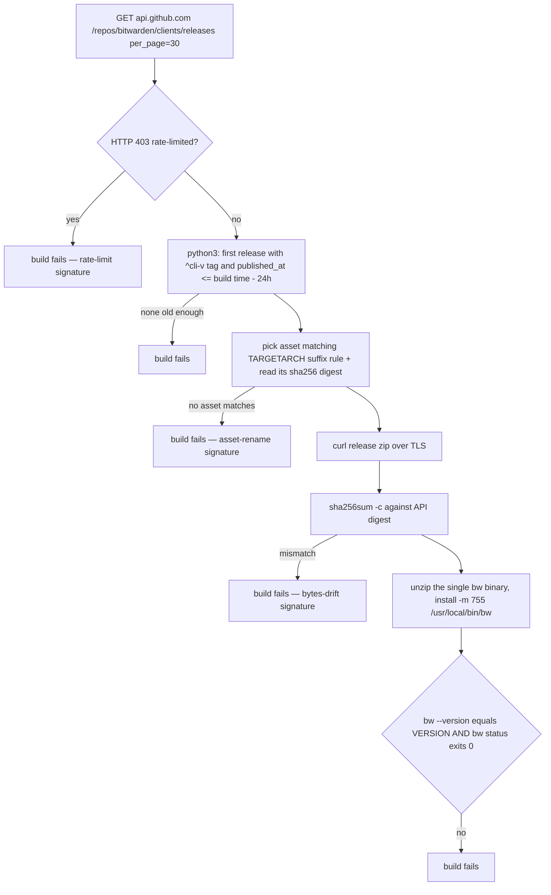

## Summary

Bake Bitwarden's vault CLI (`bw`) into the image as the repo's first fully unpinned tool: each cacheless build resolves the newest `cli-v*` release of `bitwarden/clients` through the GitHub API (tag, per-arch asset URL, and sha256 digest from one call), skips releases younger than 24 hours, and installs the native binary — no Node.js, no npm. Smoke-test gated; PR only after explicit user approval.

## Problem Frame

The user manages secrets in Bitwarden and wants the CLI available inside the devcontainer as the prerequisite for later Ansible integration — `community.general`'s bitwarden lookup shells out to `bw`, so CLI presence is the only requirement on this image; the integration itself is follow-up work. The image has no `bw` today and no Node.js runtime, which rules out the npm channel (`@bitwarden/cli` requires Node ≥ 22). Every other tool in the image is version-pinned via ARG; leaving `bw` unpinned is a deliberate user decision made after the trade-offs were surfaced — versioned image tags stop being reproducible and the weekly rebuild adopts whatever upstream published, unreviewed — accepted in exchange for always-current security patches on a secrets tool. The April 22 2026 npm-channel compromise of `@bitwarden/cli` (credential stealer, live ~90 minutes) shaped the mitigations: install from the GitHub-zip channel that incident bypassed, gate bytes on the API-published digest, and hold a 24-hour release-age floor.

## Requirements

**Installation**
- R1. `bw` on PATH for the non-root `vscode` user; `bw --version` prints the release resolved during the build (bare calver, e.g. `2026.11.1` — the resolver strips the `cli-v` prefix to derive the compared VERSION)
- R2. No version ARG exists; every cacheless build (weekly cron, `workflow_dispatch` default, `--no-cache`) resolves the newest `cli-v*` release of `bitwarden/clients`; PR and semver-tag builds read the GHA layer cache (the shared workflow's event-keyed cache-from blanks only for schedule and `workflow_dispatch`) and reuse the resolved `bw` layer — the semantics are "latest at each cacheless build", never "latest at every build"
- R3. Releases published less than 24 hours before the build are skipped; resolution falls back to the newest release at least 24 hours old
- R4. Both architectures resolve independently and install the same release except in a rare race window: `TARGETARCH` amd64 selects the asset without an arch suffix, arm64 selects the `-arm64` asset — a `cli-v*` release publishing between the two platform resolutions can land different `bw` versions in one multi-arch manifest (best-effort; the window is minutes wide against a roughly monthly release cadence)
- R5. The download is integrity-gated: sha256 from the GitHub API per-asset `digest` field is verified before install, over TLS from `github.com` only

**Function**
- R6. Account-free operation is proven in-build: `bw --version` matches the resolved release (bare calver; the upstream print format is unverified — a mismatch fails loudly at the smoke test) and `bw status` exits 0 with no account, session, or OS keyring

**Documentation and conventions**
- R8. No `.env.example` version entry appears (no ARG exists — Version mirror invariant holds); the Bitwarden release-notes URL joins the VERSION REFERENCE header; README gains a tool-table row and a runtime-auth note; CLAUDE.md records the first fully-unpinned tool in Key Conventions; CONCEPTS.md gains an "Unpinned install" entry beside Major-float pin
- R9. The block banner documents the unpinned decision and its cache semantics, the variant choice, the digest-trust disclosure, and weekly-red triage signatures (asset rename, API rate limit, digest mismatch, missing arm64 asset)

**Process**
- R10. Smoke test (`docker build .`) passes and is reported before any PR; fresh-container acceptance runs as `vscode`; the PR opens only after explicit user approval

#### Requirements.D1. R8 enumerates the CONCEPTS.md deliverable
**Decision:** R8 includes the CONCEPTS.md "Unpinned install" entry among its documentation deliverables.
**Why:** U3 edits CONCEPTS.md under an R8 citation, but R8 previously enumerated only `.env.example`, README, and CLAUDE.md — the unit's file list was unaccounted in requirement traceability.
**Source:** review agent coherence, 2026-11-27 ts-doc-review

#### Requirements.D2. Cacheless-build list corrected — PR and tag builds cache
**Decision:** R2 enumerates cacheless builds as weekly cron, `workflow_dispatch` default, and `--no-cache` only; PR and semver-tag builds read the GHA layer cache and reuse the resolved `bw` layer, so versioned tags can ship cache-stale `bw`.
**Why:** The delegated Taegost/shared-workflows docker-build-push.yml reads the GHA cache on pull_request and tag-push events (its cache-from blanks only for schedule and workflow_dispatch). R2 previously listed PR CI as cacheless, which would misdirect weekly-red triage and hide cache-stale `bw` on versioned tags; the Risks Lost-guarantees bullet now carries it.
**Source:** user, 2026-11-27 approved review agent feasibility's proposal (ts-doc-review)

#### Requirements.D3. R4 restated as best-effort dual-arch
**Decision:** Both architectures resolve the newest eligible release independently; same release in practice, differing only if a release publishes between the two platform resolutions.
**Why:** Resolution runs Dockerfile-side per platform (KTD3), so nothing shares the resolved tag across Buildx platform builds; R4 previously stated same-release as a guarantee with no mechanism behind it, whose rare violation would ship silently. U1's integration scenario is aligned.
**Source:** user, 2026-11-27 approved review agent adversarial's proposal (ts-doc-review)

---

## Key Technical Decisions

- **KTD1. Fully unpinned, resolved per cacheless build.** No version ARG, no `.env.example` entry — the Version mirror invariant ties entries to ARGs, and `ps_git_prompt.ps1` is the standing precedent for an ARG-less addition. The weekly Monday 04:00 UTC cacheless cron becomes the delivery mechanism, inverting the Drift tripwire role the same way the postgresql-client-18 float doc frames it. A break-glass lever stays documented but unimplemented: if a weekly-red bites, flip the RUN to an explicit tag as the emergency edit (see Deferred).
- **KTD2. Native zip from `bitwarden/clients`, `bw-bit` variant.** Never the archived `bitwarden/cli` repo (frozen 2022), never npm (needs Node ≥ 22 the image doesn't ship; was the compromised channel in April 2026), never Snap (amd64-only). `bw-bit-*` is the vendor's default distribution build — what `bitwarden.com/download` serves — and includes the non-OSS-licensed features (device approval) that `bw-oss-*` lacks.
- **KTD3. One unauthenticated GitHub API call supplies tag, asset, and digest.** `GET /repos/bitwarden/clients/releases?per_page=30`, parsed with python3 (present as 3.12). The list is newest-first; take the first entry whose `tag_name` matches `^cli-v` and whose `published_at` clears the 24h floor. `/releases/latest` is rejected — the monorepo shares one release stream with desktop/web/browser clients, so that endpoint can flip to a non-CLI release. The `bitwarden.com/download` redirect is rejected — amd64-only and carries no digest. Resolution runs Dockerfile-side, not CI-side: this repo's workflow delegates to an external shared workflow and cannot inject resolved values, and Dockerfile-side resolution keeps local builds identical in mechanism to CI builds; the authenticated CI-side variant stays deferred (see Scope Boundaries).
- **KTD4. 24-hour release-age floor.** Keeps the install unpinned while refusing brand-new releases long enough for community scrutiny to catch a repeat of the April 2026 exposure (~90 minutes live). With a weekly cadence the floor almost never delays anything — it only bites when a release lands the same day as a build.
- **KTD5. Integrity gate is the API `digest`, disclosed as same-host trust.** No checksum files ship with CLI releases (the docs claiming otherwise are stale). `assets[].digest` is `sha256:<hex>` — the same trust class as terragrunt/packer's SHA256SUMS: the digest travels from the same host as the artifact, so it catches corruption and drift, not a full-host compromise. The banner discloses this as integrity-only, per the az-ssh unpinned-surface disclosure convention.
- **KTD6. Asset names are discovered by regex, never hardcoded.** Match `^bw-bit-linux(-arm64)?-\d+\.\d+\.\d+\.zip$` against the release's asset list for the current `TARGETARCH`. This survives version churn automatically. A prefix-family rename remains possible — it happened 2026-11-19 (`bw-linux-` → `bw-bit-linux-`, with upstream explicitly warning that Dockerfiles break) — and is the standing weekly-red scenario, documented in the banner.
- **KTD7. Tail placement: own banner block after the ps_git_prompt block, directly before the final ownership/`USER vscode` instruction — nothing below it.** The placement minimizes invalidation on future block-text edits (no layer sits below to re-invalidate on the rename-recovery emergency edit); cacheless builds rebuild everything regardless, so the original "always-invalidating layer" framing was wrong and is corrected here — an unpinned block invalidates nothing that a pinned block wouldn't. Matches the azure-postgresql CAS ruling that standalone blocks land directly before `USER vscode`.
- **KTD8. No shell completion ships.** Upstream's completion command supports zsh only and no official bash completion exists; the user scoped completions out of this plan entirely (KTD8.D2) — nothing is vendored and nothing is hand-rolled. `/etc/bash_completion.d/` and `/usr/share/zsh/vendor-completions/` both gain nothing.

#### KTD1.D1. Fully unpinned, against the repo's pin convention
**Decision:** `bw` installs with no version pin; each cacheless build takes the newest release at least 24 hours old.
**Why:** The user wants security patches to arrive without a manual bump on this secrets-critical tool. The reproducibility and auto-adopt trade-offs were surfaced at the scoping gate — non-reproducible versioned image tags, unreviewed adoption of whatever upstream published — and the user held the unpinned choice; the 24h floor (KTD4.D1) is the accepted mitigation.
**Source:** user, 2026-11-27 scoping synthesis — chose "Fully unpinned (your original ask)" after pushback

#### KTD2.D1. `bw-bit` variant, not `bw-oss`
**Decision:** Download the `bw-bit-linux*` assets.
**Why:** That is the vendor's default distribution build — the one `bitwarden.com/download` serves and npm installs — and it includes non-OSS features such as device approval that the OSS build lacks; no reason to ship users a lesser build than the one they'd install themselves.
**Source:** plan, 2026-11-27 research — asset families verified on cli-v2026.11.1

#### KTD2.D2. Vault CLI (`bw`) only, not Secrets Manager (`bws`)
**Decision:** Install only `bw`; no `bws`.
**Why:** The user named the vault CLI; `bws` requires a paid Secrets Manager subscription. Ansible integration can proceed against `bw` (BW_SESSION) if that subscription never materializes.
**Source:** user, 2026-11-27 scoping synthesis — chose "bw only"

#### KTD4.D1. 24-hour release-age floor
**Decision:** The resolver skips releases published less than 24 hours before the build.
**Why:** Research surfaced the April 22 2026 npm-channel compromise of `@bitwarden/cli` — live ~90 minutes, caught only by victim reports. A floor keeps the unpinned semantics (still the latest release old enough to have survived scrutiny) at near-zero cost under the weekly cadence.
**Source:** user, 2026-11-27 research-surfaced question — chose "24h floor (Recommended)"

#### ~~KTD8.D1. Vendor zsh completion instead of skipping completions entirely~~
**Status:** Superseded by KTD8.D2 — completions cut from scope by user decision, 2026-11-27.
**Decision:** Generate and install zsh completion in a separate RUN.
**Why:** Upstream ships a working zsh completion generator and the base image ships zsh + oh-my-zsh, so the marginal cost is one RUN; skipping would leave the image's primary interactive shell without completion for a heavily used CLI. Bash gets nothing because nothing official exists to install.
**Source:** plan, 2026-11-27 — researchers split skip-vs-vendor; vendor chosen for the above

#### KTD8.D2. No completion ships — zsh cut from scope
**Decision:** No completion is vendored for any shell; R7 and U2 are removed from the plan (IDs not renumbered — gaps preserved).
**Why:** The user scoped completions out — the repo is bash-focused in their usage and zsh was never user-approved (KTD8.D1 was plan-sourced). Upstream ships no bash completion, so bash loses nothing. The base image shipping zsh + oh-my-zsh does not obligate this repo to vendor zsh completions.
**Source:** user, 2026-11-27 ts-doc-review walkthrough — chose "Cut zsh entirely"

#### KTD3.D1. Resolver justification corrected on jq availability
**Decision:** KTD3 no longer justifies python3 parsing by jq's absence; jq ships in the image (transitive dependency of yq). The justification is python3's fit for the combined JSON, date-floor, and regex resolution.
**Why:** Feasibility review verified `/usr/bin/jq` present in the built image; a false image fact would otherwise propagate into the block banner and the U3 doc edits. Mechanism unchanged.
**Source:** review agent feasibility, 2026-11-27 ts-doc-review

#### KTD6.D1. Asset regex is bit-only
**Decision:** The discovery regex matches the `bw-bit` family only: `^bw-bit-linux(-arm64)?-\d+\.\d+\.\d+\.zip$`.
**Why:** The prior `(bit|oss)` alternation admitted the `bw-oss-*` assets, contradicting KTD2.D1's bit-variant decision and the HTD exact-values table — two matches per architecture would fail resolution or install the OSS build.
**Source:** review agent coherence, 2026-11-27 ts-doc-review

#### KTD7.D1. Placement moved to directly before `USER vscode`
**Decision:** The `bw` block lands after the ps_git_prompt block, immediately before the final ownership/`USER vscode` instruction — nothing below it.
**Why:** The prior position (before the PSReadLine blocks) left two layers below the block, so every edit to this deliberately edit-prone block — including the documented rename-recovery emergency edit — would re-invalidate those layers in cached builds, contradicting KTD7's own invalidation-minimizing rationale. The repo's azure-postgresql CAS ruling places standalone blocks directly before `USER vscode`.
**Source:** user, 2026-11-27 approved review agent feasibility's proposal (ts-doc-review)

---

## Scope Boundaries

Non-goals for this plan:

- Ansible-side integration — lookup wiring, playbooks, BW_SESSION plumbing, `--passwordenv` patterns; `community.general`'s bitwarden lookup shells out to `bw`, so CLI presence is the only prerequisite this image owes
- `bws` Secrets Manager CLI — user chose the vault CLI (KTD2.D2)
- Node.js runtime or the npm channel — rejected install route (KTD2)
- shell completions (zsh or bash) — cut from scope by user decision; nothing vendored (KTD8.D2)
- CI workflow changes — the workflow delegates to `Taegost/shared-workflows`; platform and cache behavior are external invariants

### Deferred to Follow-Up Work

- `docs/solutions/tooling-decisions/` entry via ts-compound after merge — the unpinned pattern, the rename incident, the digest-trust disclosure, and the firsts this lands (first unpinned tool, first GitHub-API-resolved install)
- Break-glass pin ARG if a weekly-red rename bites — flip the RUN to an explicit tag as the documented emergency edit; promote to an ARG + mirror entry only if recurrence makes it worth the invariant cost
- Authenticated `gh api` tag resolution in CI if unauthenticated rate limits become a standing weekly-red
- Release-age floor tuning (e.g. 7 days) if security posture changes

---

## Risks & Dependencies

- **Supply-chain window on an unpinned secrets CLI.** A compromised or broken newest release reaches the image on the next cacheless build. Mitigations: 24h floor, GitHub-zip channel (the channel the April 2026 npm compromise bypassed), digest gate, banner disclosure. Residual: the digest is same-host trust — integrity, not provenance (KTD5).
- **Asset-rename recurrence.** Precedent: `cli-v2026.11.0` (2026-11-19) renamed `bw-linux-` → `bw-bit-linux-` with an explicit upstream warning that direct-download scripts break. The regex absorbs version churn only; a family rename redds the weekly build at the resolution step — banner carries the signature and the one-block recovery.
- **GitHub API rate limit.** 60 req/h unauthenticated per IP; shared CI runner IPs can exhaust it. One call per build keeps the profile low; failure signature documented; retry arrives with the next cron. Escape hatch deferred above.
- **arm64 native assets are vendor-undocumented.** Bitwarden's docs still say "For arm64 devices, install the CLI using npm" — stale; arm64 zips have shipped since `cli-v2026.2.0`. CI's QEMU arm64 PR build is the only proof; npm+Node is the documented but rejected fallback if arm64 native disappears.
- **Image size.** The unpacked native binary is ~150 MB — the largest single tool in the image by a wide margin. Accepted; disclose in the PR body.
- **Lost guarantees, accepted at synthesis.** Versioned image tags (1.2.3, 1.2) are no longer byte-reproducible, and the weekly build's Drift tripwire role inverts into the delivery mechanism. Versioned tags also carry cache-stale `bw`: PR and tag builds read the GHA layer cache, so a tag build ships whatever the last cacheless build resolved, not the newest release. User-accepted (KTD1.D1); disclosed per the az-ssh convention rather than assumed away.
- **calver, not semver.** Releases are `YYYY.M.PATCH`; the resolver takes API list order (newest-first) and never sorts — semver assumptions would misorder across years.
- **FIDO2-only 2FA accounts cannot authenticate to the CLI** (no WebAuthn support; authenticator-app/email methods work). A README note ships with U3 so users discover this before it bites.

---

## High-Level Technical Design

One RUN resolves, verifies, installs, and asserts:



Directional sketch of the block shape (not the literal Dockerfile text):

```dockerfile
# --- Bitwarden CLI (bw) ---
# banner: first fully-unpinned tool (explicit user decision, KTD1.D1);
# cache semantics (latest at each cacheless build, cached builds reuse);
# variant choice; digest = same-host integrity disclosure; weekly-red
# triage signatures: asset rename / API 403 / sha mismatch / missing arm64
RUN <fetch releases JSON> \
    && <python3: emit TAG, VERSION (TAG minus the cli-v prefix), ASSET_URL, SHA256 for TARGETARCH, enforcing the 24h floor and the arch suffix rule> \
    && <curl asset to /tmp> \
    && <sha256sum -c> \
    && <unzip single bw to /usr/local/bin, mode 755> \
    && bw --version | grep -qx "$VERSION" \
    && bw status > /dev/null \
    && <cleanup /tmp>
```

Exact values for the implementer:

| Item | Value |
|---|---|
| API endpoint | `https://api.github.com/repos/bitwarden/clients/releases?per_page=30` (unauthenticated, newest-first) |
| Tag filter | `^cli-v`; calver `cli-vYYYY.M.P`; at planning the latest was `cli-v2026.11.1` (2026-11-24) |
| Age floor | release `published_at` ≤ build time − 24h (published more than 24 hours before the build) |
| Asset regex | `^bw-bit-linux(-arm64)?-\d+\.\d+\.\d+\.zip$`; amd64 → no suffix, arm64 → `-arm64` |
| Integrity | `assets[].digest` = `sha256:<hex>` from the same API response |
| Binary facts | zip contains exactly one `bw` ELF, ~150 MB, dynamically linked against glibc ≥ 2.28 (noble ships 2.39; libstdc++/libgcc present in base) — no extra apt packages |
| Version assertion | resolver emits `VERSION` = TAG minus the `cli-v` prefix; `bw --version` prints the bare calver and is compared against `VERSION` — format mismatch fails loudly at the smoke test |
| Install target | `/usr/local/bin/bw`, mode 755 |

#### HTD.D1. Age-floor comparator corrected
**Decision:** The flowchart resolver node and the exact-values Age floor row select releases with `published_at <= build time - 24h` — published more than 24 hours before the build.
**Why:** Both locations previously stated `>=`, which passes only releases younger than 24h (defeating R3 and the KTD4.D1 floor decision) and fails the normal-week case, so nearly every weekly build would red at the none-old-enough branch. The prose — R3, KTD4, the U1 age-floor scenario — already stated the correct direction; only the two comparator symbols were wrong.
**Source:** user, 2026-11-27 approved review agents feasibility and security's proposal (ts-doc-review)

#### HTD.D2. Version assertion defined against resolver-emitted VERSION
**Decision:** The python3 resolver emits a fourth value, `VERSION` = TAG minus the `cli-v` prefix; the in-RUN assertion compares `bw --version` against `VERSION`; R1 and R6 note the binary prints the bare calver.
**Why:** The resolver emits a `cli-v`-prefixed tag while the binary prints bare calver (e.g. `2026.11.1`), and the sketch's `<resolved version>` placeholder left the compared string undefined — one implementer greps the raw tag and reds every build, another silently strips the prefix with no documented basis. The upstream print format is unverified; a mismatch fails loudly at the smoke test per the repo's loud-failure convention.
**Source:** user, 2026-11-27 approved review agent coherence's proposal (ts-doc-review)

---

## Implementation Units

### U1. Add the Bitwarden CLI install block to the Dockerfile

- **Goal:** Working, integrity-gated, always-current-at-cacheless-build `bw` in the image, every failure loud
- **Requirements:** R1 (bw on PATH for vscode), R2 (unpinned, per-cacheless-build resolution), R3 (24h age floor), R4 (dual-arch, same release), R5 (digest-gated download), R6 (account-free in-build proof), R9 (banner with triage signatures)
- **Dependencies:** none
- **Files:** `Dockerfile`
- **Approach:** Banner-commented block per the HTD pipeline, placed after the ps_git_prompt block and directly before the final ownership/`USER vscode` instruction — nothing below it (KTD7). The resolver, floor, arch-suffix rule, and assertions follow KTD1–KTD7; the python3 parse step fails the build with distinct messages per failure class so the weekly-red signature is identifiable from the log alone. `unzip` is already in the system-packages layer.
- **Patterns to follow:** terragrunt block (`Dockerfile:183-194`) for the digest-gate shape; postgresql-client-18 block (`Dockerfile:653-715`) for banner/tripwire framing; ArgoCD block (`Dockerfile:484-489`) for `install -m` to `/usr/local/bin`
- **Test scenarios:**
  - Happy path: `docker build .` passes; the log shows the resolved tag; `bw --version` equals it; `bw status` exits 0 unauthenticated
  - Edge (age floor): newest release younger than 24h → resolver selects the previous release; log identifies the skipped tag
  - Edge (cache): a warm rebuild reuses the layer and re-resolves nothing; a `--no-cache` rebuild resolves fresh (R2 semantics proven both ways)
  - Error path: asset family renamed → no regex match → build fails at resolution with the rename signature
  - Error path: API returns 403 → build fails at fetch with the rate-limit signature
  - Error path: digest mismatch → `sha256sum -c` fails before anything installs
  - Integration: PR CI builds `linux/amd64` and `linux/arm64`, each platform resolving independently — same release except in the rare cross-platform publication window (R4 best-effort)
  - Integration: fresh container as `vscode` — `/usr/local/bin/bw` on PATH, account-free commands run without a keyring or session
- **Verification:** Smoke build green with all in-RUN assertions; no temp artifacts left; no version ARG introduced

### U3. Docs: README, `.env.example` header, CLAUDE.md, CONCEPTS.md

- **Goal:** The tool is advertised, the unpinned convention is recorded where contributors look, and the mirror invariant stays intact
- **Requirements:** R8 (docs and mirror-invariant conventions)
- **Dependencies:** U1 (block details)
- **Files:** `README.md`, `.env.example`, `CLAUDE.md`, `CONCEPTS.md`
- **Approach:** README — "What's Inside" row for Bitwarden CLI with Version column `Unpinned — latest at build, see Dockerfile`; a Bitwarden paragraph beside the Cloud CLI Authentication notes covering interactive `bw login`, the `BW_SESSION` flow, the FIDO2-2FA limitation, and a warning never to place `BW_CLIENTID`/`BW_CLIENTSECRET`/`BW_PASSWORD` in image ENV or `devcontainer.json` `containerEnv` (they leak via `docker inspect`). `.env.example` — no version entry (invariant); add the Bitwarden release-notes URL to the VERSION REFERENCE header. CLAUDE.md — Key Conventions bullet recording the first fully-unpinned tool, the API resolution + 24h floor mechanism, and why it deviates. CONCEPTS.md — add an "Unpinned install" entry beside Major-float pin (gap-fill lands with the code, per the postgresql-plan precedent).
- **Test expectation:** none — documentation-only unit
- **Verification:** No `BW_VERSION`-style entry appears in `.env.example`; README row and auth note present; CLAUDE.md and CONCEPTS.md carry the convention

### U4. Smoke test, acceptance, approval-gated PR

- **Goal:** Prove the change end-to-end and gate the PR per the repo directive
- **Requirements:** R10 (smoke test, acceptance, approval-gated PR)
- **Dependencies:** U1 (install block), U3 (docs)
- **Files:** none — validation and process unit
- **Approach:** `docker build -t devops-toolbox:local .` and report the result (ABSOLUTE DIRECTIVE). Acceptance in a fresh container as the shipping user: `bw --version` prints the resolved release; `bw status` returns unauthenticated JSON cleanly. Local smoke covers amd64 only — arm64 confirmation comes from the CI PR build; state that in the report. Await explicit user approval; then open the PR. The PR body carries the unpinned rationale with its accepted trade-offs, the April 2026 incident context for the floor and channel choice, and the image-size note.
- **Test scenarios:**
  - Acceptance: fresh container as `vscode` — `bw --version` and `bw status` outputs shown in the report; `docker run --rm -u vscode devops-toolbox:local bw --version`
  - Process: build result reported before any PR is drafted; PR opened only after the user explicitly approves
- **Verification:** Build green, acceptance output shown, approval recorded, PR open

---

## Sources & Research

- Bitwarden CLI docs — install channels, BW_SESSION, `--apikey`/`BW_CLIENTID`/`BW_CLIENTSECRET`, `--passwordenv`, `BITWARDENCLI_APPDATA_DIR`, zsh completion appendix, FIDO2 limits: https://bitwarden.com/help/cli/
- Releases and API — tag stream `cli-v*`, asset families, per-asset `digest`: https://github.com/bitwarden/clients/releases , `https://api.github.com/repos/bitwarden/clients/releases`; current at planning `cli-v2026.11.1` (2026-11-24)
- Asset-rename warning in the `cli-v2026.11.0` release notes (2026-11-19) — direct-download scripts must update filenames
- Digest-verification guidance (docs stale on checksum files; API digest is the live mechanism): https://bitwarden.com/help/security-faqs/
- Vendor latest redirect (amd64-only, rejected): `https://bitwarden.com/download/?app=cli&platform=linux`
- CLI source facts — zsh-only completion (`apps/cli/src/commands/completion.command.ts`), `BW_NOINTERACTION` (`apps/cli/src/auth/commands/login.command.ts`), no keyring references in the CLI entry
- npm registry — `@bitwarden/cli` dist-tags (channel verified alive; Node ≥ 22 requirement)
- April 22 2026 npm-channel compromise reporting — michelebologna.net/2026/wait-a-week-before-you-update/ ; passwork.pro/blog/inside-a-supply-chain-attack/ (OX Security / StepSecurity attribution)
- Repo precedents — terragrunt digest gate (`Dockerfile:183-194`), postgresql-client-18 banner and float rationale (`Dockerfile:653-715`, `docs/solutions/tooling-decisions/postgresql-client-18-pgdg-major-float-pin.md`), az-ssh unpinned-surface disclosure (`docs/solutions/tooling-decisions/az-cli-extensions-system-install.md`), `CONCEPTS.md` (Version mirror, Drift tripwire, Smoke test, ARG-per-block)
- Prior plans for skeleton and process — `docs/plans/2026-10-15-002-feat-add-postgresql-client-18-plan.md` (add-tool shape, acceptance as `vscode`, arm64-via-CI posture), `docs/plans/2026-11-19-001-feat-powershell-git-prompt-plan.md` (no-ARG, no-mirror-entry precedent)
- User decisions — 2026-11-27 scoping synthesis: fully unpinned (held after pushback), `bw` only, 24h release-age floor
